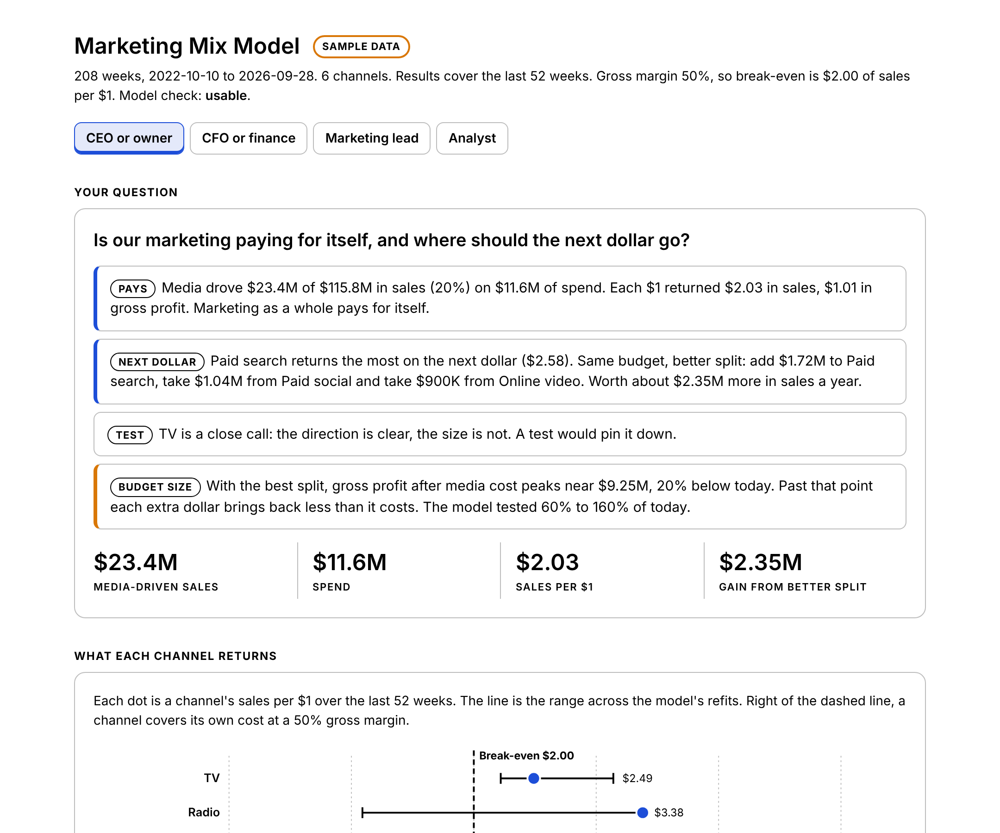
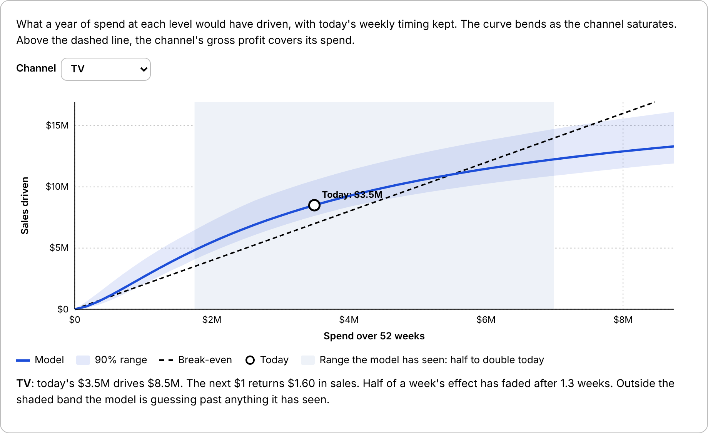

# Marketing Mix Model

## What problem does it solve?

Every ad platform claims credit for the same sale. Finance asks what marketing actually returns, and nobody can answer with a number that holds up.

## How does it solve it?

Upload weekly sales and spend by channel. Claude fits a marketing mix model: it splits each week's sales into base, seasons, holidays, events, outside forces like price and the economy, and what each channel drove, with carry-over and saturation built in. Then it refits itself 40 times on resampled misses to see which answers hold.

## What does it unlock?

Sales per dollar and the next dollar's return for every channel, a Grow, Hold, Trim or Cut verdict, how sure the model is, which channel to test next, and the best split of the budget.

## Four readouts, one model

Tell Claude your seat. The math is the same. The answer is built for the question you bring.

| Seat | The question it answers |
|---|---|
| CEO or owner | Is our marketing paying for itself, and where should the next dollar go? |
| CFO or finance | What does marketing actually return, and how sure are we? |
| Marketing lead or agency | Which channels can I defend, and what mix should I run? |
| Analyst | Can I trust this model? |

## What makes it different from other mix models?

It says where it is guessing. Most mix models hand back one number per channel. This one refits itself 40 times on resampled misses, curves included, and labels every verdict:

| Certainty | What it means | What the budget plan does |
|---|---|---|
| Clear | 80% of refits reach the same verdict | Moves money |
| Close call | The direction holds, the size does not | Moves money, flags it |
| Test first | The refits disagree, or its spend moves with another channel | Holds the channel at today's spend |

The plan never grows a Cut or Trim channel and never shrinks a Grow channel.

The test list ranks the channels history cannot settle. Run a geo holdout or lift test on the first one, give Claude the result, and the model anchors that channel to it. Use the model to decide what to test, and the tests to anchor the model.

## What does the tool show?

- Sales per $1 for every channel with its range, against break-even at your margin
- The test list, with the reason each channel is on it
- Response curves: what each level of spend drives, where the channel saturates, and where it stops paying
- The best split of today's budget, and a budget slider from 60% to 160% of today that shows where profit peaks
- Where last year's sales came from
- The model check: actual against modelled sales, with held-back weeks the model never saw

## What do I need first?

Read [the prerequisites](../skills/marketing-mix-model/references/prerequisites.md). The short version:

- Any Claude plan with code execution on
- One CSV, one row per week: a week date, sales in dollars, one spend column per channel
- 52 weeks at minimum, 104 or more to separate seasons from trend
- Spend that moved: each channel needs at least 8 weeks of spend
- Your gross margin
- Optional: price, promotions, events, economic series, and any lift test results

The [data guide](../skills/marketing-mix-model/references/data-guide.md) shows the layout. No connectors or MCP servers are needed.

## How do I use it?

1. Build the weekly file.
2. Upload it to Claude and say: "What does each channel actually drive? I'm the CFO. Our gross margin is 45%." Swap in your own seat and margin.
3. Open the tool file Claude hands back.

No data handy? Say "Run the marketing mix model demo." Claude builds an invented home-improvement brand with known answers planted in it, and the tool shows the model against the truth. Or try [the sample data](../examples/marketing-mix-model/) and open the [sample tool](../examples/marketing-mix-model/sample_tool.html).

## What will it not do?

- Prove cause. A mix model finds patterns in history. A lift test proves cause, and when they disagree, the test wins
- Recommend moving budget on a channel it cannot settle
- Quote a result outside half to double today's spend
- Measure a channel that ran at the same level every week
- Read leads or orders. Convert them to dollars first
- Use a result as a driver. Orders, leads, clicks and impressions columns are left out

## How was it tested?

Five test files: a clean one with almost no noise, a messy export with a dozen planted problems, one too short, one monthly and one daily. On the clean file its median miss on each channel's planted return is under 3%, and it gets 6 of 6 verdicts right. On the realistic sample, with noise, channels that overlap and search that follows demand, it gets 5 of 6 verdicts right and the true return falls inside its range for 4 of 6 channels. Feeding in one simulated lift test that read radio at $1.61 per $1 pulls the model's worst miss, radio, from $3.38 to $1.68. Radio's true return is $1.61. Every count on the messy file matched an answer key built from how the file was made. See [tests](../tests/marketing-mix-model/).

Built from an MMM prototype by Bill Becht, Marketing Systems Guild.
